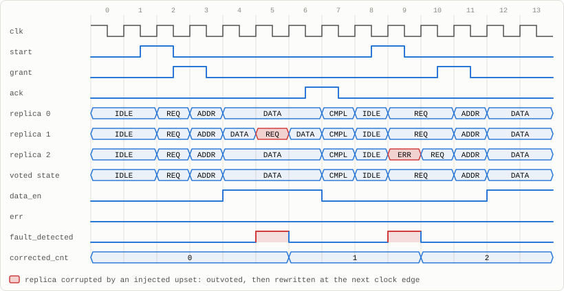
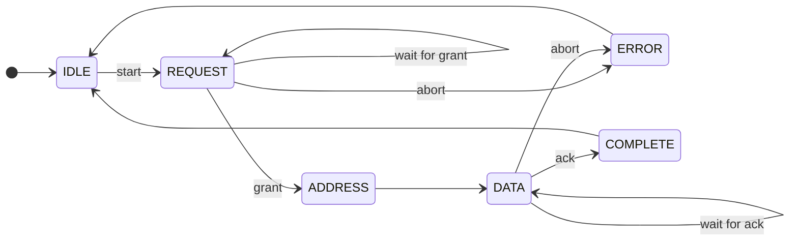
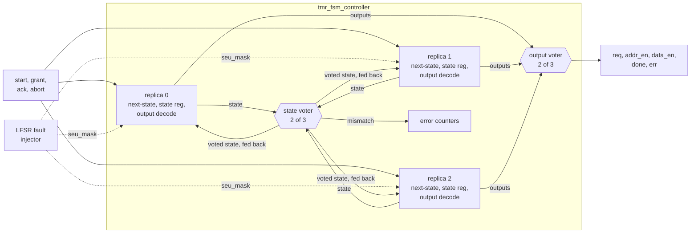

# Fault-Tolerant FSM Controller (TMR)

[](https://github.com/Divabhattacharya/fault-tolerant-fsm-controller/actions/workflows/tests.yml)


A bus-transaction controller FSM protected by **Triple Modular Redundancy**.
The repo also includes an on-chip LFSR fault injector, error counters and an
automated fault-injection testbench. A bit flip in any one replica is outvoted
immediately and rewritten on the next clock edge, without a reset.

<p align="center">
  <picture>
    <source media="(prefers-color-scheme: dark)" srcset="docs/waveform-dark.svg">
    
  </picture>
  <br>
  <sub>Two injected upsets, captured from simulation. In cycle 5 replica 1 flips from DATA to REQ;
  in cycle 9 replica 2 flips from REQ to ERR. The voted state and the outputs never change:
  <code>data_en</code> stays high and <code>err</code> stays low.
  Each corrupted replica is back in step one cycle later, and <code>corrected_cnt</code> counts both upsets.</sub>
</p>

## At a glance

| | |
|---|---|
| **Protected FSM** | 6-state bus-transaction sequencer, 3-bit state, Moore outputs |
| **Redundancy** | 3 replicas, with a bitwise 2-of-3 vote on the state and on the outputs |
| **Recovery** | voter feedback rewrites a corrupted replica on the next edge: 1 cycle, no reset |
| **Fault injector** | 16-bit maximal-length LFSR (period 65,535); rate 2<sup>-0</sup> … 2<sup>-8</sup> per cycle; flips one bit of one replica per fault |
| **Error counters** | corrected-fault count plus per-replica "outvoted" counts, 16-bit saturating |
| **Verification** | 178,845 cycles checked against a golden model · 57,480 injected upsets · **0 escapes** · 54/54 fault bins |
| **Synthesis** | all 3 replicas (9 state flip-flops) survive flattened synthesis, asserted by `make synth` |

## The controller



| State | Code | Output asserted |
|---|:---:|---|
| IDLE | `000` | – |
| REQUEST | `001` | `req` |
| ADDRESS | `010` | `addr_en` |
| DATA | `011` | `data_en` |
| COMPLETE | `100` | `done` |
| ERROR | `101` | `err` |
| unused | `110`, `111` | none; next state is IDLE |

## Architecture



- **Voter feedback, the key design choice.** Each replica computes its next
  state from the *voted* state, not from its own register, so a corrupted
  replica is overwritten with the correct value on the next edge. Without
  feedback, a corrupted replica would stay wrong. A later upset in a second
  replica would then outvote the only good one. With feedback, each upset can
  affect the vote for at most one cycle.
- **Voted outputs.** Each replica decodes its own outputs, and the outputs are
  voted as well, so the output decoder is triplicated too.
- **Fault injector.** One LFSR bit field decides whether a fault fires
  (probability 2<sup>-rate</sup>). Two other fields choose the replica and the
  state bit. The resulting mask is XOR-ed into the value that replica's state
  register captures, which models a single-event upset.

### Synthesis gotcha: the redundancy can be optimized away

In a production build the injector is tied off, which makes the three replicas
logically identical. A flattening synthesis run then merges them back into one
register and deletes the error counter, so the design loses its redundancy
without any warning. Yosys does this:

| Flattened synthesis, injection tied off | State flip-flops | Error counter |
|---|:---:|:---:|
| Replicas without `keep_hierarchy` | 3 (merged) | removed |
| Replicas marked `keep_hierarchy` / `dont_touch` (this repo) | **9** | kept |

`make synth` asserts that three replica instances with three state flip-flops
each survive. With the attributes removed, the build fails.

## Verification

A behavioral golden model of the *unprotected* FSM runs in lockstep with the
design. On every cycle the checker verifies that:

- the voted state and every voted output match the golden model;
- each replica equals *golden state XOR the upset applied at the last edge*.
  This proves the upset landed, the other two replicas were untouched, and the
  hit replica recovered one cycle later;
- `fault_detected` is high exactly when an upset was applied.

| Suite | Scope | Result |
|---|---|---|
| Reset values | state, outputs, counters, LFSR seed | pass |
| Fault-free run | directed scenario + 20,000 random cycles | 11/11 legal transitions covered, 0 false detections |
| Directed single-bit upsets | every replica × bit × cycle of a scenario that visits all 6 states | 144 runs, 54/54 state × replica × bit bins |
| Multi-bit upsets | upset patterns `011`–`111` (including 2- and 3-bit flips) confined to one replica | 240 runs, all corrected |
| LFSR random campaigns | 5 fault rates × 30,000 cycles, random inputs | see below |
| Reset under injection | 100 async resets while faults fire every cycle | all state and counters cleared |
| LFSR period | cycle until the seed repeats | 65,535 (maximal) |
| Known limits | same-bit upset in two replicas; common-mode upset into `110`/`111` | escape is visible to the checker; illegal code returns to IDLE in 1 cycle |

**Random campaigns.** For each rate, the injector's count, the controller's
corrected count, the per-replica counters and the testbench's own tally must
all agree.

| Fault rate | Cycles | Upsets injected | Detected and corrected | Output errors |
|---|---:|---:|---:|---:|
| every cycle | 30,000 | 30,000 | 30,000 | 0 |
| 1 / 2 | 30,000 | 15,082 | 15,082 | 0 |
| 1 / 4 | 30,000 | 7,618 | 7,618 | 0 |
| 1 / 16 | 30,000 | 1,970 | 1,970 | 0 |
| 1 / 64 | 30,000 | 524 | 524 | 0 |

In 57,456 of the 57,480 upsets, the hit replica's own outputs were wrong; the
voter masked every one. Replica selection uses `lfsr[11:8] % 3`, so replica 0
is hit slightly more often (about 37% vs 31%).

### The testbench catches real bugs

Each of these bugs was injected into the RTL on its own, and every one was
caught:

| Injected bug | Errors reported |
|---|---:|
| OR instead of a majority vote | 306,457 |
| No voter feedback (next state from the replica's own register) | 222,541 |
| Injector hits two replicas at once | 215,146 |
| Outputs taken from replica 0 only | 21,574 |
| `corrected_count` misses faults | 262 |
| No recovery from illegal state codes | 2 |
| Missing LFSR tap (non-maximal period) | 1 |
| Replicas without `keep_hierarchy` | `make synth` fails |

## Run it

Requires Icarus Verilog and Yosys. Tested locally with Icarus Verilog 13.0 and
Yosys 0.70. GitHub Actions re-runs everything on every push using Ubuntu's
packaged versions.

```bash
make test     # automated fault-injection testbench
make synth    # synthesize the full top, then the production config flattened,
              # asserting 3 replicas x 3 state flip-flops survive
make wave     # rebuild with a VCD dump for GTKWave
```

## Scope and limits

TMR masks any upset confined to one replica at a time, including multi-bit
upsets. It cannot mask the same bit flipping in two replicas in the same cycle,
or a common-mode upset of all three. The testbench demonstrates both cases. The
voters, inputs, clock and reset are not triplicated.

## Repository layout

```
rtl/
  ctrl_fsm_defs.vh        state encoding
  ctrl_fsm_replica.v      one FSM copy: next state from the voted state, upset port, output decode
  tmr_voter.v             bitwise 2-of-3 voter with per-input disagreement flags
  tmr_fsm_controller.v    3 replicas + state and output voters + error counters
  lfsr_fault_injector.v   LFSR-driven single-bit upset generator + injection counter
  ft_fsm_top.v            system top: controller + injector + directed-upset test port
syn/
  tmr_fsm_prod.v          production configuration (injection tied off) for the synthesis check
tb/
  tb_ft_fsm.v             automated fault-injection testbench with golden model
docs/                     waveform figures
Makefile
```
